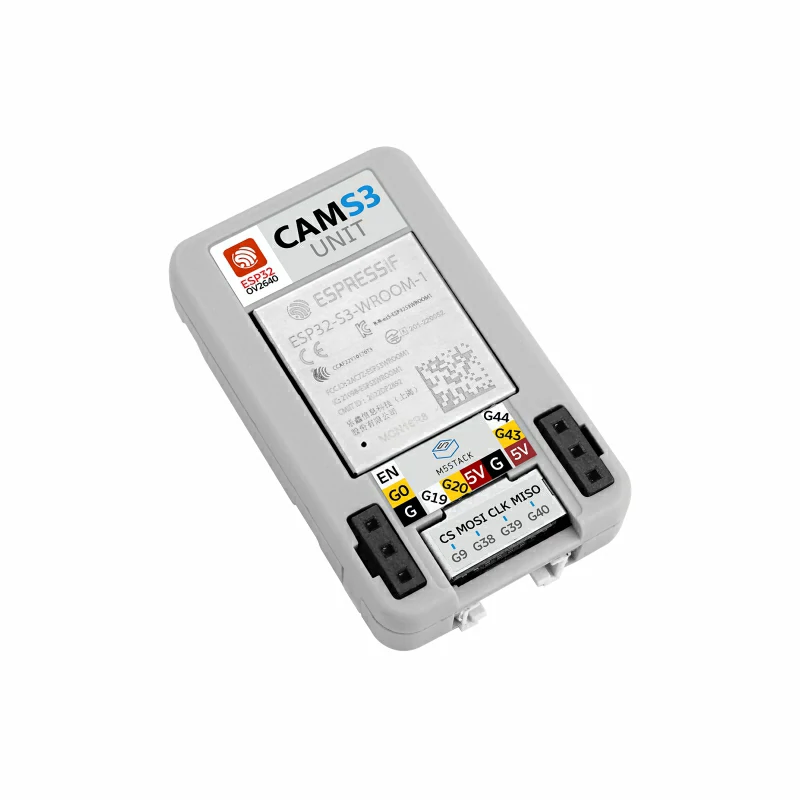
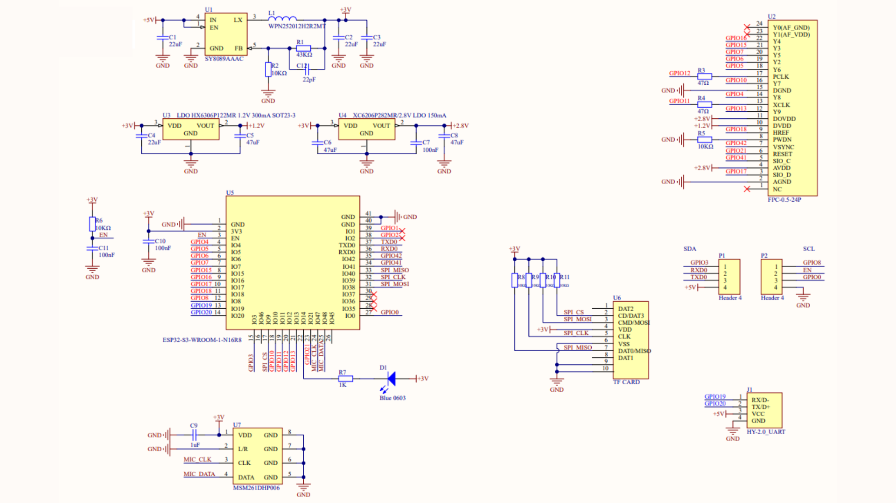
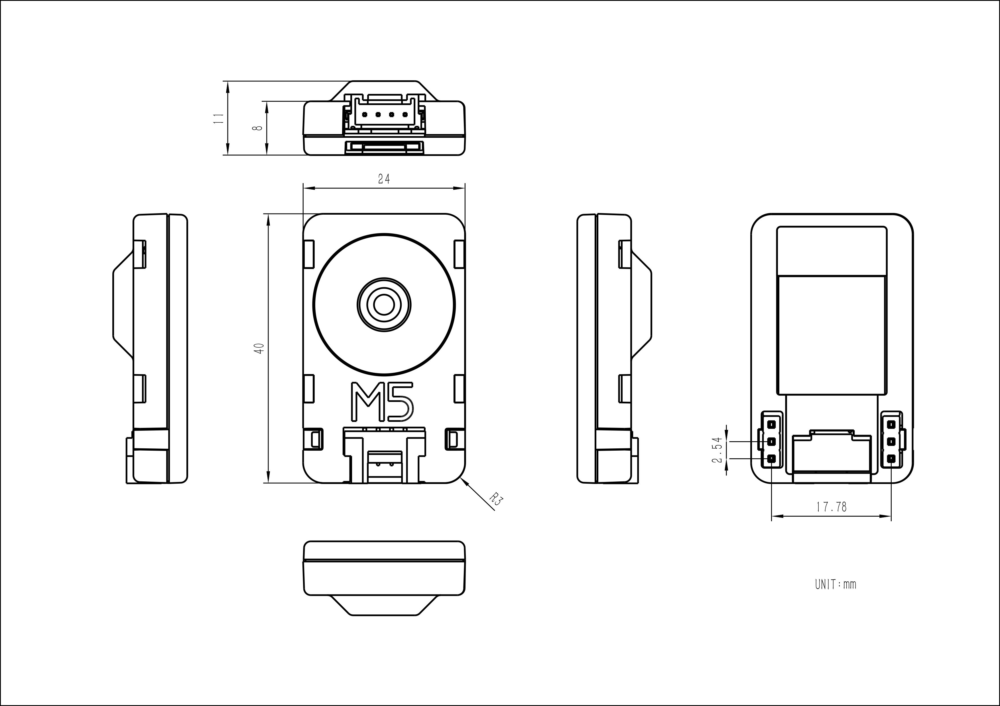

# M5Stack Unit CamS3

What we need for functionality

- M5Stack Unit CamS3 board with OV2640 camera module [here](#esp32)
- Supported camera modules [here](#cam_modules)
- How to upload firmware to the board [here](#flash_fw)
- How to compile software in the Arduino IDE [here](#arduino_cfg)
- How to connect camera board to Prusa Connect [here](#prusa_connect)
- How to reset configuration to factory settings [here](#factory_cfg)
- Status LED [here](#status_led)
- Schematic and pinout [here](#schematic)
- Power supply [here](#power_supply)
- Potential issue [here](#issue)

<a name="esp32"></a>
## M5Stack Unit CamS3

Basic information:

- ESP32-S3-WROOM-1-N16R8 processor module
- 16MB FLASH and 8MB PSRAM
- OV2640 2MP camera
- Internal WiFi antenna
- Micro SD card slot and PDM microphone
- Programmable status LED on GPIO14
- USB programming through the Grove2USB-C adapter

This guide covers the **Unit CamS3 (U174)** with the OV2640 camera. Manufacturer documentation is available [here](https://docs.m5stack.com/en/unit/Unit_CamS3).


The hardware images below are saved locally. Their original M5Stack URLs and retrieval details are listed in [SOURCES.md](SOURCES.md).

<a name="cam_modules"></a>
## Supported camera modules

| Camera chip | FOV | Resolution | Tested | Works | Description |
|-------------|-----|------------|--------|-------|-------------|
| OV2640 | 66.5° | 2MP | Yes | Yes | Standard camera module |

The CamS3-5MP is a different camera variant and is not covered by this configuration.

<a name="flash_fw"></a>
## How to upload firmware to the board

Use the **Grove2USB-C adapter**, a Grove cable, a USB data cable and a jumper wire. The Grove port carries the ESP32-S3 native USB signals.



- Build the firmware with the Arduino IDE settings [below](#arduino_cfg).
- Disconnect power and connect the camera's Grove port to the Grove2USB-C adapter.
- Connect **G0 (GPIO0)** to **GND** on the exposed pin header, then connect the adapter to the computer using the USB data cable.
- When the serial port appears, remove the jumper and select the port under **Tools -> Port**.
- For the first upload, set **Tools -> Erase All Flash Before Sketch Upload -> Enabled**. This clears saved settings.
- Select **Sketch -> Upload** and wait for it to finish.
- Disconnect and reconnect power with **G0 disconnected from GND** to start the firmware.

For later updates, set **Erase All Flash Before Sketch Upload -> Disabled** to preserve the camera settings. Repeat the download-mode procedure if the uploader cannot connect. If uploading at 921600 fails, try 115200.

This board is not yet included in `fw_build.sh`, so a precompiled release archive is not available. Build and upload from source using the instructions below.

<a name="arduino_cfg"></a>
## How to compile software in the Arduino IDE

Install the Arduino IDE, ESP32 board support and libraries listed in the [main instructions](../../README.md#arduino_lib), then open `ESP32_PrusaConnectCam/ESP32_PrusaConnectCam.ino`.

In [mcu_cfg.h](../../ESP32_PrusaConnectCam/mcu_cfg.h), enable only the M5Stack board:

```c
#define AI_THINKER_ESP32_CAM            false
#define ESP32_WROVER_DEV                false
#define CAMERA_MODEL_ESP32_S3_DEV_CAM   false
#define CAMERA_MODEL_ESP32_S3_EYE_2_2   false
#define CAMERA_MODEL_XIAO_ESP32_S3_CAM  false
#define CAMERA_MODEL_ESP32_S3_CAM       false
#define ESP32_S3_WROOM_FREENOVE         false
#define ESP32_M5_UNIT_CAMS3             true
```

Board configuration in the Arduino IDE, matching the [board configuration header](../../ESP32_PrusaConnectCam/module_ESP32-M5_Unit_CamS3.h):

- Tools -> Board -> ESP32 Arduino -> ESP32S3 Dev Module
- Tools -> USB CDC on BOOT -> Disabled
- Tools -> CPU Frequency -> 240MHz (WiFi/BT)
- Tools -> Core debug level -> None
- Tools -> USB DFU on BOOT -> Disable
- Tools -> Erase all Flash Before Sketch Upload -> Disable (first flash or configuration recovery = enable)
- Tools -> Events Run On -> Core 0
- Tools -> Flash Mode -> QIO 80MHz
- Tools -> Flash Size -> 8MB
- Tools -> Jtag Adapter -> Disable
- Tools -> Arduino Runs On -> Core 0
- Tools -> USB Firmware MSC On Boot -> Disable
- Tools -> Partition scheme -> Minimal SPIFFS (1.9MB APP with OTA/190KB SPIFFS)
- Tools -> PSRAM -> OPI PSRAM
- Tools -> Upload Mode -> UART0 / Hardware CDC
- Tools -> Upload Speed -> 921600
- Tools -> USB Mode -> Hardware CDC and JTAG
- Tools -> Zigbee mode -> Disable

The physical board has **16MB flash**. The **8MB** setting above follows the current board configuration and does not use all of the physical flash.

<a name="prusa_connect"></a>
## How to connect camera board to Prusa Connect

Follow the [main Prusa Connect setup instructions](../../README.md#prusa_connect) to configure WiFi and the camera token.

Find the camera's IP address in the router's client list; it may appear as `esp32s3-...`. Open `http://<camera-ip>/` to access the web interface. Alternatively, use `http://prusa-esp32cam.local` if mDNS is available.

- JPEG snapshot: `http://<camera-ip>/saved-photo.jpg`
- Video stream: `http://<camera-ip>/stream.mjpg`

<a name="factory_cfg"></a>
## How to reset configuration to factory settings

The current board configuration uses **GPIO0** for configuration reset. However, grounding this pin before powering on selects download mode, so the generic reset procedure does not clear the camera settings on this board.

To reset the settings, repeat the [firmware upload procedure](#flash_fw) with **Erase All Flash Before Sketch Upload -> Enabled**. This removes saved WiFi details, the camera token and other settings. After uploading, disable flash erasing, remove the jumper, restart the camera and configure it again.

<a name="status_led"></a>
## Status LED

The onboard status LED is connected to **GPIO14**. The blinking patterns are described in the [main status LED guide](../../README.md#status_led).

<a name="schematic"></a>
## Schematic and pinout

The M5Stack schematic is saved [here](schematic.png).



Hardware connections from the manufacturer documentation and schematic:

| Function | ESP32-S3 GPIO |
|----------|---------------|
| Camera SCCB data / clock | 17 / 41 |
| Camera external clock | 11 |
| Camera VSYNC / HREF / pixel clock | 42 / 18 / 12 |
| Camera data D0–D7 | 6, 15, 16, 7, 5, 10, 4, 13 |
| Camera reset | 21 |
| Grove USB D+ / D− | 20 / 19 |
| Status LED | 14 |
| Micro SD CS / MOSI / CLK / MISO | 9 / 38 / 39 / 40 |
| PDM microphone clock / data | 47 / 48 |

These are hardware connections; firmware feature support is described [below](#issue). The current camera configuration leaves `RESET_GPIO_NUM` set to `-1`.

The dimensions drawing is saved [here](dimensions.jpg).



<a name="power_supply"></a>
## Power Supply

Supply **5V USB power** through the Grove2USB-C adapter and Grove cable. Leave **G0 disconnected from GND** for normal operation.

<a name="issue"></a>
## Potential issue with this board

- Micro SD card operation has not been verified on this board.
- Camera flash and DHT sensor support are disabled in the current configuration. The PDM microphone is not supported by this firmware.
- Cloud updates require a board-specific release binary, which is not yet produced by `fw_build.sh`. For manual OTA updates, upload the application binary from a matching CamS3 build through the web interface's **System** tab.
- The manufacturer's factory firmware has different WiFi defaults and features. Follow this project's setup instructions after uploading PrusaConnect firmware.
