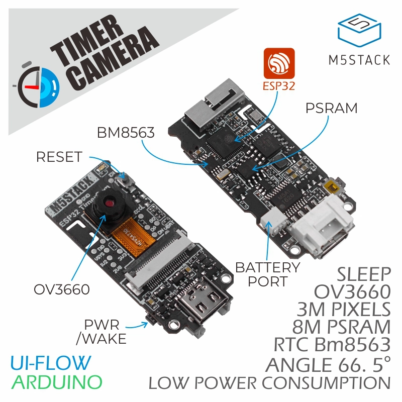
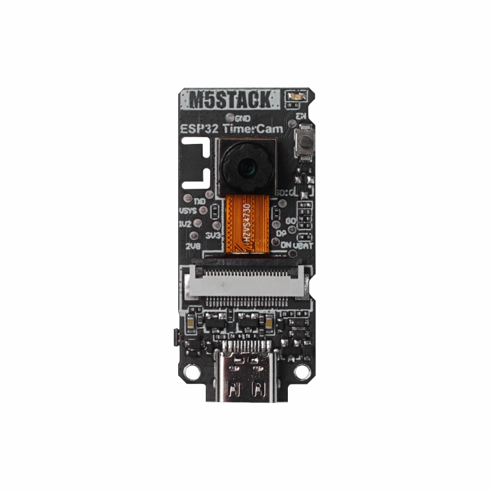
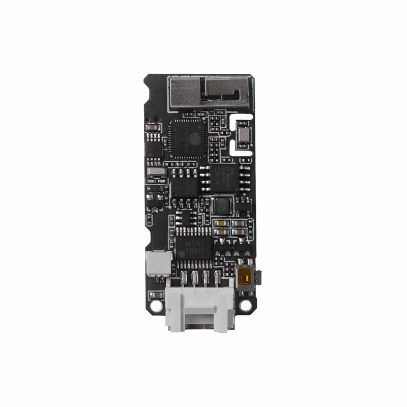

# M5Stack Timer Camera

What we need for functionality

- M5Stack Timer Camera board with OV3660 camera module [here](#esp32)
- Supported camera modules [here](#cam_modules)
- How to upload firmware to the board [here](#flash_fw)
- How to compile software in the Arduino IDE [here](#arduino_cfg)
- How to connect camera board to Prusa Connect [here](#prusa_connect)
- How to reset configuration to factory settings [here](#factory_cfg)
- Status LED [here](#status_led)
- Schematic and pinout [here](#schematic)
- Power supply [here](#power_supply)
- Potential issue [here](#issue)

<a name="esp32"></a>
## M5Stack Timer Camera

Basic information:

- ESP32-D0WDQ6-V3 processor
- 4MB FLASH and 8MB PSRAM
- OV3660 3MP camera, field of view 66.5°
- Internal WiFi antenna
- USB-C port for power supply, firmware upload and serial console
- Status LED on GPIO2
- RTC BM8563, battery port, PWR and RESET buttons
- HY2.0-4P port (GPIO4, GPIO13, 5V, GND)
- No micro SD card slot

Manufacturer documentation is available [here](https://docs.m5stack.com/en/unit/timercam) and [here](https://docs.m5stack.com/en/unit/timercam_f) (Timer Camera F).



 

**This board is not tested with the firmware version 1.1.3 yet.** The OV3660 camera module of the Timer Camera was tested on the Ai-Thinker ESP32-cam board.

<a name="cam_modules"></a>
## Supported camera modules

| Camera chip | FOV | Resolution | Tested | Works | Description |
|-------------|-----|------------|--------|-------|-------------|
| OV3660 | 66.5° | 3MP | Yes (on Ai-Thinker) | Yes | Standard camera module of the Timer Camera |

The web interface offers the resolutions from 320x240 to 1920x1080. The resolution 1600x1200 was tested.

<a name="flash_fw"></a>
## How to upload firmware to the board

Connect the camera to the computer with a USB-C data cable and select its serial port. On some systems, a driver for the USB to UART converter of the board is necessary, see the [manufacturer documentation](https://docs.m5stack.com/en/unit/timercam).

The precompiled firmware for this board is published with the release: `m5stack-timercam.zip`, the file for the firmware update is `M5STACK_TIMERCAM.bin`.

The partitions table and the addresses of the files are the same as for the [Ai-Thinker ESP32-cam](../AI_Thinker-ESP32-cam/README.md):

- address **0x1000** - **ESP32_PrusaConnectCam.ino.bootloader.bin**
- address **0x8000** - **ESP32_PrusaConnectCam.ino.partitions.bin**
- address **0x10000** - **ESP32_PrusaConnectCam.ino.bin**

Command for the first firmware upload with esptool, where **/dev/ttyUSB0** is the serial port of the camera:

```
./esptool -p /dev/ttyUSB0 -b 460800 --before default_reset --after hard_reset --chip esp32 write_flash --erase-all --flash_mode dio --flash_size 4MB --flash_freq 80m 0x1000 ESP32_PrusaConnectCam.ino.bootloader.bin 0x8000 ESP32_PrusaConnectCam.ino.partitions.bin 0x10000 ESP32_PrusaConnectCam.ino.bin
```

The parameter **--erase-all** erases the entire flash including the camera configuration. For a firmware update, remove this parameter, or upload the file `M5STACK_TIMERCAM.bin` through the web interface's **System** tab.

<a name="arduino_cfg"></a>
## How to compile software in the Arduino IDE

Install the Arduino IDE, ESP32 board support and libraries listed in the [main instructions](../../README.md#arduino_lib), then open `ESP32_PrusaConnectCam/ESP32_PrusaConnectCam.ino`.

In [mcu_cfg.h](../../ESP32_PrusaConnectCam/mcu_cfg.h), enable only the Timer Camera:

```c
#define AI_THINKER_ESP32_CAM            false
#define ESP32_WROVER_DEV                false
#define CAMERA_MODEL_ESP32_S3_DEV_CAM   false
#define CAMERA_MODEL_ESP32_S3_EYE_2_2   false
#define CAMERA_MODEL_XIAO_ESP32_S3_CAM  false
#define CAMERA_MODEL_ESP32_S3_CAM       false
#define ESP32_S3_WROOM_FREENOVE         false
#define M5STACK_TIMERCAMERA             true
#define ESP32_M5_UNIT_CAMS3             false
```

Board configuration in the Arduino IDE, matching the [board configuration header](../../ESP32_PrusaConnectCam/module_M5Stack_TimerCam.h):

- Tools -> Board -> ESP32 Arduino -> M5TimerCAM
- Tools -> CPU Frequency -> 240MHz (WiFi/BT)
- Tools -> Core debug level -> None
- Tools -> Erase all Flash Before Sketch Upload -> Disable **(first flash, new board = enable. otherwise = disable)**
- Tools -> Flash frequency -> 80MHz
- Tools -> Flash Mode -> DIO
- Tools -> PSRAM -> Enabled
- Tools -> Partition scheme -> Minimal SPIFFS (1.9MB APP with OTA/190KB SPIFFS)

When flashing the firmware to a new board for the first time, set **Tools -> Erase all Flash Before Sketch Upload -> Enable**. For later updates, set it to **Disable**, otherwise the camera configuration is erased with every upload.

The serial console is available on the USB-C port.

<a name="prusa_connect"></a>
## How to connect camera board to Prusa Connect

Follow the [main Prusa Connect setup instructions](../../README.md#prusa_connect) to configure WiFi and the camera token.

<a name="factory_cfg"></a>
## How to reset configuration to factory settings

To reset the settings to factory defaults, follow these instructions. The reset uses **GPIO4** on the HY2.0-4P port, the PWR button cannot be used.

- Connect **GPIO4** on the HY2.0-4P port to **GND**.
- **Plug in** the power supply.
- Wait for **10 seconds**.
- After 10 seconds, the **STATUS LED will start flashing**.
- **Disconnect** **GPIO4** from **GND** (but don't disconnect the power supply).
- The **STATUS LED** will **stop flashing**, and the MCU will **automatically reboot**.
- Now the MCU is in the factory settings.

The configuration can be reset also from the serial console with the command `resetcfg;`, see the [main instructions](../../README.md#serial_cfg).

<a name="status_led"></a>
## Status LED

The onboard status LED is connected to **GPIO2**. The blinking patterns are described in the [main status LED guide](../../README.md#status_led).

<a name="schematic"></a>
## Schematic and pinout

The M5Stack schematic is saved [here](Sch_M5TimerCAM.pdf). Datasheets: [ESP32](esp32_datasheet_en.pdf), [OV3660](OV3660_datasheet.pdf).

| Function | ESP32 GPIO |
|----------|------------|
| Camera SCCB data / clock | 25 / 23 |
| Camera external clock | 27 |
| Camera VSYNC / HREF / pixel clock | 22 / 26 / 21 |
| Camera data D0–D7 | 32, 35, 34, 5, 39, 18, 36, 19 |
| Camera reset | 15 |
| Status LED | 2 |
| HY2.0-4P port | 4, 13 |
| Battery hold / battery ADC | 33 / 38 |
| RTC BM8563 SDA / SCL | 12 / 14 |

<a name="power_supply"></a>
## Power Supply

Supply **5V USB power** through the USB-C port. Battery operation is not supported: the firmware does not use the battery hold pin (GPIO33), and the camera runs only with an external power supply.

<a name="issue"></a>
## Potential issue with this board

- The board has no micro SD card slot. Logs are available only on the serial console, and timelapse photos are not saved.
- Camera flash, DHT sensor and RTC are not supported by this firmware.
- The manufacturer's factory firmware has different features. Follow this project's setup instructions after uploading PrusaConnect firmware.
